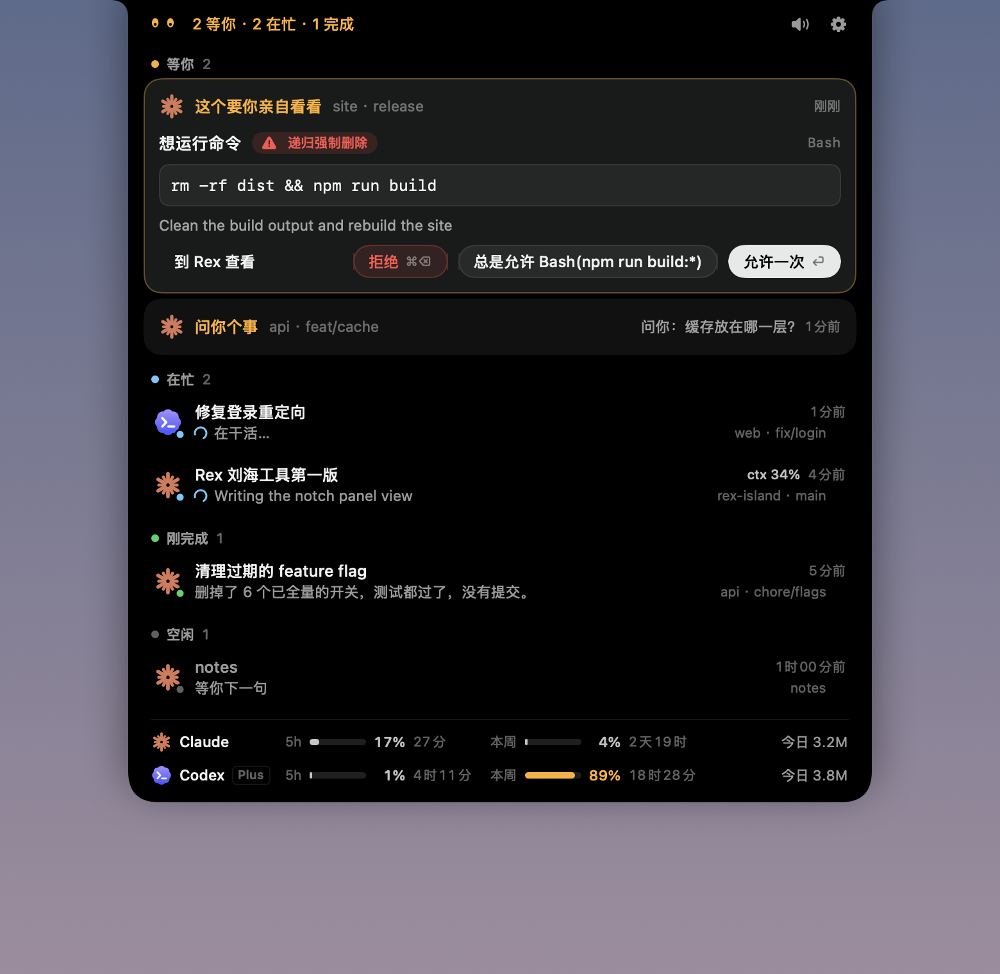
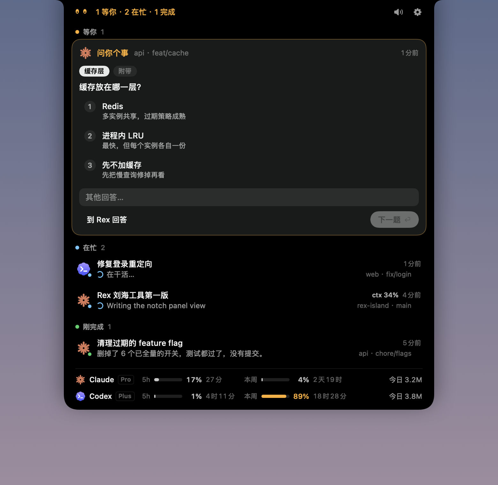
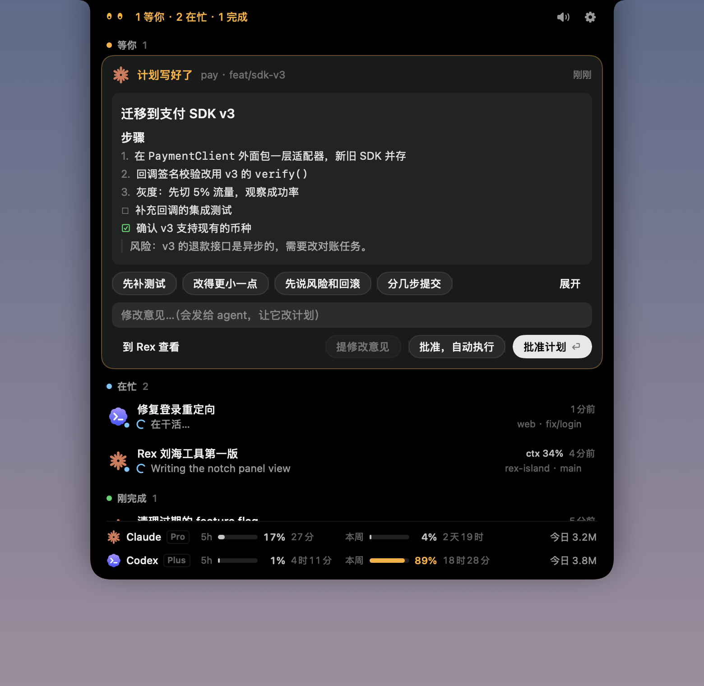

# Rex Island

在 MacBook 刘海里盯着 [Rex](https://www.superlogical.com/rex) 里跑的 Claude Code 和 Codex：谁在干活、谁在等你、谁刚做完，以及套餐额度还剩多少。需要你拍板的请求可以直接在刘海里处理，不用切回终端。



| 收起：眼睛 + 计数 + 额度告警 | 有新请求：短暂弹出横幅 |
| --- | --- |
|  |  |

| 问答（多问题、多选） | 计划审阅 |
| --- | --- |
|  |  |

## 能做什么

- **看状态**：Rex 里每个 agent 面板一行，按"等你 / 在忙 / 出错 / 刚完成 / 空闲"分组。显示话题、正在做什么、项目和分支、上下文占用，点一下跳到 Rex 里对应的面板。
- **审批**：允许一次、拒绝，以及 Claude 自己给出的"总是允许 …"。高风险命令（`rm -rf`、强制推送、`curl | sh`……）会标红，横幅里也不提供一键允许，要先展开看清楚。
- **回答问题**：Claude 的 `AskUserQuestion`，支持多个问题、多选和自由输入。
- **审阅计划**：Markdown 渲染，可以提修改意见让 Claude 重写，或者批准执行。
- **额度和消耗**：Claude、Codex 各自的 5 小时窗口和本周额度、重置倒计时、"偏快"提示（用量跑在时间前面），以及今天消耗的 token 数。任一窗口用到 80% 以上时，收起状态的右侧会多出一个圆环和百分比（比如 Codex 本周 89%），左右两侧会一起变宽，保证内容不被刘海挡住。
- **不打扰**：只在有新请求时弹出几秒；你正看着那个面板时不提醒；在终端里先回答了，卡片会自动消失。

快捷键：`⌃⌥N` 打开或收起面板。面板打开时，`⏎` 允许或提交，`⌘⌫` 拒绝，`1`–`9` 选择选项，`↑↓` 切换请求，`Esc` 收起。

## 安装

需要 macOS 14 及以上、Rex，以及 Xcode 或 Command Line Tools（提供 `swiftc`）。

```sh
scripts/build.sh test      # 跑测试
scripts/build.sh install   # 构建并安装到 ~/Applications，然后启动
scripts/build.sh dmg       # 打包 .build/Rex-Island-<版本>.dmg，发给别人用
```

### 用 DMG 安装（给同事）

DMG 只做了 ad-hoc 签名，没有经过 Apple 公证。所以从网上下载后，macOS 会拦住它，可能提示"无法打开"甚至"已损坏"（文件本身没有问题）。按下面做一次就好：

1. 打开 DMG，把 Rex Island 拖进"应用程序"。
2. 在终端运行一次，去掉下载标记：
   ```sh
   xattr -dr com.apple.quarantine "/Applications/Rex Island.app"
   ```
3. 正常打开 Rex Island，在弹出的设置窗口里按需接入。

如果不想用终端：先双击打开一次（会被拦下），再到"系统设置 → 隐私与安全性"，在页面底部点"仍要打开"。如果提示的是"已损坏"，这个按钮不会出现，只能用上面的命令。

之后更新到新版本，同样需要重复第 2 步。

第一次启动会打开设置窗口，在里面逐项点"接入"：

| 接入项 | 改动的文件 | 作用 |
| --- | --- | --- |
| Claude Code：审批、问答、计划 | `~/.claude/settings.json` 增加 `PermissionRequest`、`UserPromptSubmit`、`Stop` 三个 hook | 把请求送到刘海，再把你的回答送回去 |
| Claude Code：额度 | 把 `statusLine` 换成一层包装命令 | Claude Code 只把套餐额度交给状态栏。包装命令先记下额度，再用同样的输入运行你原来的状态栏（比如 claude-hud），所以你的状态栏显示不变 |
| Codex：审批 | `~/.codex/hooks.json` 增加同样三个 hook | 接入后要在 Codex 里运行一次 `/hooks` 信任它们，否则 Codex 会静默跳过 |

安装器只增删 Rex Island 自己的条目，可以重复执行。每个文件第一次被改动前，会在旁边留一份 `.rexisland-backup`。点"断开"会移除这些条目，状态栏也会恢复成原来的命令。

hook 只在 Rex 面板里生效（看 `REX_BLOCK` 环境变量）。Rex Island 没有运行时，hook 立即退出，agent 照常在终端里问你。

## 工作原理

```
Rex 服务 ──rex events --all --json──▶ Rex Island ◀──Unix socket── rexisland-bridge ◀── agent hook
   ▲       (每个面板的 OSC 7501 状态)      │                         （等待你的回答）
   └── rex api / send-key（跳转、批准计划）─┘
```

- **状态以 Rex 为准**。Claude Code 和 Codex 会通过 Rex 的 [Program Status Protocol](https://www.superlogical.com/rex/docs/build/program-status) 上报 `working`、`blocked`、`done` 等状态，所以 hook 没接入时也能看到状态。
- **决策内容来自 hook**。`PermissionRequest` hook 会一直挂着，直到你在刘海里回答，回答会作为 hook 的输出交给 agent。
- **在终端里先回答了怎么办**：Claude Code 不会结束还在等待的 hook，所以 Rex Island 以 Rex 的状态为准：面板一离开 `blocked`（或者换成了另一个提示），对应的卡片就作废，挂着的 hook 也会被关掉。
- **计划批准走按键**：Claude Code（2.1.325 实测）收到 hook 对 `ExitPlanMode` 的 allow 后，并不会收起计划对话框。所以"批准计划"是在 Rex 面板里按下对应的菜单项：先确认 Rex 仍显示 `approve plan`，再从屏幕上读出选项编号，按下后确认面板已经继续；任何一步不对，就改为跳到 Rex 让你自己处理。"提修改意见"仍然走 hook。
- **套餐**：Claude 的套餐（Pro、Max 5x……）读自 `~/.claude.json` 里 `oauthAccount.organizationType`，这只是 Claude Code 缓存的账户资料，不是登录凭证。Codex 的套餐读自它日志里的 `plan_type`。
- **额度**：Claude 的数据来自状态栏包装命令写下的 `~/Library/Application Support/RexIsland/claude-status/<session>.json`。Codex 的数据来自 `~/.codex/sessions/**/rollout-*.jsonl` 里最新的 `rate_limits`。今天的 token 数从两边的本地转录文件增量统计，不发任何网络请求，也不读取任何登录凭证。

命令行（脚本或排查问题时用）：

```sh
B="$HOME/Library/Application Support/RexIsland/bin/rexisland-bridge"
"$B" ctl status                      # 各面板状态和额度
"$B" ctl list                        # 等你处理的请求
"$B" ctl open <面板 ID 的末尾几位>      # 在 Rex 里打开那个面板（和点击会话行一样）
"$B" ctl decide <id> allow|deny [理由]
"$B" ctl answer <id> "答案1" "选项a, 选项b"
```

## 代码结构

| 目录 | 内容 |
| --- | --- |
| `Sources/Core` | 只依赖 Foundation 的业务逻辑：Rex 输出解析、面板和决策的状态归约（`Board`）、hook 载荷解析和回答编码、额度扫描、配置安装器。全部有测试覆盖 |
| `Sources/App` | AppKit + SwiftUI：刘海窗口、视图、Rex CLI 客户端、socket 服务、设置窗口 |
| `Sources/Bridge` | `rexisland-bridge`：agent hook、状态栏包装、`ctl` |
| `Sources/Shared` | 上面两者共用的路径和 socket 协议 |
| `Tests` | 基于断言的测试，`scripts/build.sh test` 运行 |

构建直接用 `swiftc`，不用 SwiftPM：有些 Command Line Tools 安装里的 SwiftPM 解析 manifest 时会链接失败。`scripts/build.sh` 还会用 VFS overlay 屏蔽 Command Line Tools 升级后残留的 `module.modulemap`（否则会报 `redefinition of module 'SwiftBridging'`），不需要 sudo。

`scripts/build.sh snapshot` 会用演示数据把各个界面状态渲染到 `docs/screenshots/`，改界面时可以对照。

## 已知限制

- 只支持 Rex 里的 Claude Code 和 Codex，并且只处理本机的 Rex 服务（不含 `rex hosts` 上的其他机器）。
- Codex 只能审批。它的提问和计划只会显示为"等你"，需要到 Rex 里处理（Codex 的 hook 不接受 `updatedInput`）。
- 点会话跳转需要在 Rex 设置的 Rex Server 页面打开 **Remote Control**：Rex 显示哪个标签页是 App 自己的状态，只有开启了 Remote Control，外部程序才能切换它（Rex Radar 也有同样的要求）。没开时，面板顶部会提示，并给出"打开 Rex 设置"按钮。如果同一台 Mac 上连着多个 Rex App 客户端，会选择最后连上的那个。
- "你正看着这个面板就不提醒"只能判断面板是否是其所在会话当前标签页的焦点，无法知道 Rex App 当前显示的是哪个会话。
- agent 在干活时，眼睛和转圈动画会让 CPU 占用保持在 5% 左右。
- 没有签名公证，见下面的"分发"。

## 分发

同类项目的做法：

| 项目 | 安装包 | 渠道 | 签名 | 自动更新 |
| --- | --- | --- | --- | --- |
| CodeIsland | DMG | GitHub Releases + 自己的 Homebrew tap（`brew install --cask codeisland`） | Developer ID 签名并公证 | Sparkle |
| Pip | zip | GitHub Releases + 自己的 Homebrew tap | ad-hoc，没有公证（cask 安装时会去掉隔离属性） | 每天检查一次新版本并提示 |

Rex Island 现在的做法：`scripts/build.sh dmg` 打出 DMG，放到 GitHub Releases，按上面"用 DMG 安装"的步骤安装。之后如果要让安装更顺滑，再补三件事：Apple Developer ID 签名和公证（需要 Apple 开发者账号，做完后就不用 `xattr` 了），一个 Homebrew tap，以及 Sparkle 自动更新。

致谢见 [NOTICE.md](NOTICE.md)：窗口、眼睛和额度的读取方式参考了 [Pip](https://github.com/Kikatsu/pip-notch)，问答回传的格式参考了 [CodeIsland](https://github.com/wxtsky/CodeIsland)，Rex 状态协议的用法参考了 [Rex Radar](https://github.com/hecspc/rex-radar) 和 [rex-inbox](https://github.com/captjt/rex-inbox)。
